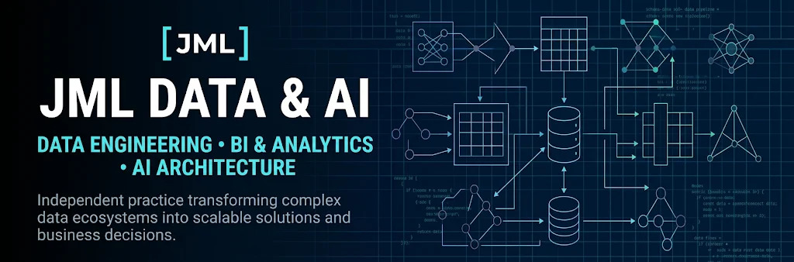

## About

**JML Data & AI** is an independent data engineering and Business Intelligence practice focused on turning raw operational data into reliable pipelines, governed semantic layers, and decision-ready analytics products.

Every solution is designed around **reproducibility, cost-efficient cloud architecture, and measurable business impact**.

## Core Capabilities

- **Data Engineering & Lakehouse Architecture:** Automated ETL/ELT pipelines, medallion architectures (Bronze / Silver / Gold), API ingestion, and CI/CD DataOps workflows.
- **Business Intelligence & Data Governance:** Executive dashboards, semantic modeling, enterprise BI administration, data cataloging, and automated data quality checks.
- **Applied AI & Predictive Analytics:** Text-to-SQL conversational analytics assistants and explainable machine learning models deployed as interactive web apps.

## Core Tech Stack

| Layer | Technologies |
| :--- | :--- |
| **Data Engineering & Cloud** | Python, PySpark, Databricks, Delta Lake, SQL, GCP, BigQuery, Redshift, Airflow, SSIS |
| **Databases & ORM** | PostgreSQL, SQL Server, SQLite, SQLAlchemy |
| **BI & Visualization** | Power BI, MicroStrategy, Tableau, Looker, Streamlit, Plotly |
| **AI & Machine Learning** | LangChain, XGBoost, SHAP |
| **DataOps & Governance** | Docker, GitHub Actions, Alation, Soda Data Quality |

## Featured Solutions & Live Demos

| Solution | Focus & Stack | Access |
| :--- | :--- | :--- |
| **Retail Price Intelligence** | Automated competitive pricing ETL (`Databricks`, `PySpark`, `Delta Lake`, `GitHub Actions`, `Power BI`) | [Portfolio Case](https://juan-manuel-landa.netlify.app/) |
| **Sales AI Chatbot** | Text-to-SQL & visual analytics assistant (`LangChain`, `BigQuery`, `Docker`, `GCP`, `Streamlit`) | [Live App](https://jml-ventas-ai.streamlit.app) |
| **Smart Credit ML** | Explainable credit risk scoring (`XGBoost`, `SHAP`, `BigQuery`, `Streamlit`) | [Live App](https://jml-smartcredit-ml.streamlit.app) |
| **Argentine ADRs Pipeline** | End-to-end financial analytics & PDF reporting (`Python`, `yfinance`, `SQLAlchemy`, `Plotly`) | [Live App](https://jml-dashboard-adr.streamlit.app) |

## Connect

Looking to build a modern data pipeline, optimize BI reporting, or deploy an AI analytics prototype?

- Explore the full project catalog at **[juan-manuel-landa.netlify.app](https://juan-manuel-landa.netlify.app/)**
- Connect via **[LinkedIn](https://www.linkedin.com/company/jml-data-ai/)** or **[GitHub (@jlandaa)](https://github.com/jlandaa)**
